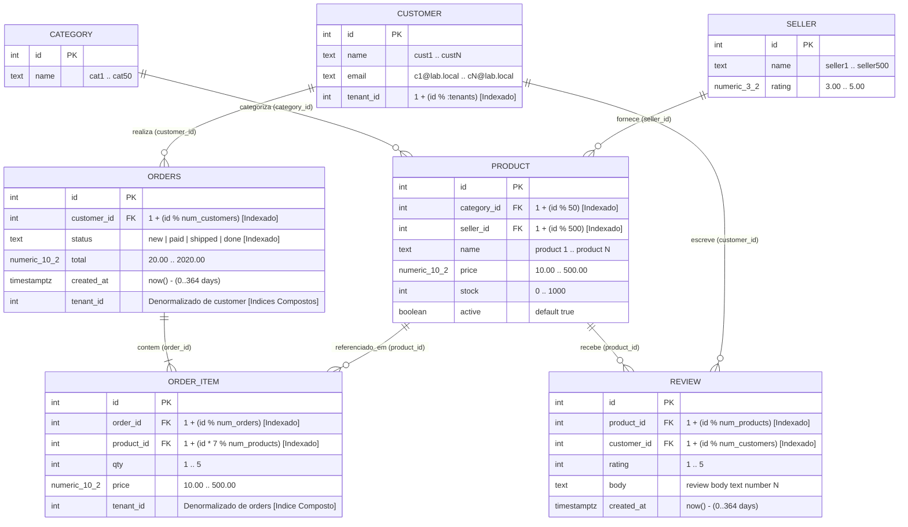

# Modelagem do Banco de Dados e Catálogo de Queries SQL Multi-Tenant

> 🇺🇸 **[English version](README.md)**

Este diretório contém todos os scripts de carga SQL do `pgbench` utilizados para comparar o **PostgreSQL 17 (Origem / Caminho A)** contra o **PgCache (Proxy de Cache de Leitura / Caminho B)** em dashboards operacionais leves, cargas mistas de leitura/escrita e telas corporativas multi-tenant complexas (pesquisa textual por substring, cadeias de `INNER JOIN` e `LEFT JOIN` de 4 a 6 tabelas e agregações analíticas multidimensionais).

---

## Sumário

1. [Visão Geral dos Arquivos de Carga](#1-visão-geral-dos-arquivos-de-carga)
2. [Modelagem do Banco de Dados e Diagrama Entidade-Relacionamento](#2-modelagem-do-banco-de-dados-e-diagrama-entidade-relacionamento)
   - [2.1 Diagrama Entidade-Relacionamento (Mermaid)](#21-diagrama-entidade-relacionamento-mermaid)
   - [2.2 Tabelas, Cardinalidades e Fatores de Escala](#22-tabelas-cardinalidades-e-fatores-de-escala)
   - [2.3 Passo 1 — Esquema Base Normalizado (`sql/01-schema.sql`)](#23-passo-1--esquema-base-normalizado-sql01-schemasql)
   - [2.4 Passo 2 — Denormalização Multi-Tenant e Indexação (`sql/02-tenant.sql`)](#24-passo-2--denormalização-multi-tenant-e-indexação-sql02-tenantsql)
   - [2.5 Catálogo Completo de Índices](#25-catálogo-completo-de-índices)
3. [Invariantes de Protocolo e Design de Queries para o PgCache](#3-invariantes-de-protocolo-e-design-de-queries-para-o-pgcache)
4. [Cargas Baseline (Varreduras `01`–`03`)](#4-cargas-baseline-varreduras-0103)
   - [4.1 `dashboard.sql` — Dashboard Operacional SaaS (8 Declarações)](#41-dashboardsql--dashboard-operacional-saas-8-declarações)
   - [4.2 `write.sql` — Carga de Escrita Escopada por Tenant (1 Declaração)](#42-writesql--carga-de-escrita-escopada-por-tenant-1-declaração)
5. [Cargas Complexas Multi-Tenant (`04-complex-sweep.sh`)](#5-cargas-complexas-multi-tenant-04-complex-sweepsh)
   - [5.1 `complex-search.sql` — Pesquisa Textual por Substring (`ILIKE '%...%'`, 4 Declarações)](#51-complex-searchsql--pesquisa-textual-por-substring-ilike--4-declarações)
   - [5.2 `complex-joins.sql` — Cadeias Profundas de `JOIN` e `LEFT JOIN` em 4 a 6 Tabelas (4 Declarações)](#52-complex-joinssql--cadeias-profundas-de-join-e-left-join-em-4-a-6-tabelas-4-declarações)
   - [5.3 `complex-analytics.sql` — Agregações Analíticas Multidimensionais (4 Declarações)](#53-complex-analyticssql--agregações-analíticas-multidimensionais-4-declarações)
   - [5.4 `complex-dashboard.sql` — Tela Corporativa Unificada de Analytics e Busca (8 Declarações)](#54-complex-dashboardsql--tela-corporativa-unificada-de-analytics-e-busca-8-declarações)
   - [5.5 `complex-dashboard-zipfian.sql` — Tráfego Corporativo Pareto 80/20 (8 Declarações)](#55-complex-dashboard-zipfiansql--tráfego-corporativo-pareto-8020-8-declarações)
6. [Resumo de Desempenho entre Cargas (Cluster de 3 Nós na Nuvem)](#6-resumo-de-desempenho-entre-cargas-cluster-de-3-nós-na-nuvem)

---

## 1. Visão Geral dos Arquivos de Carga

| Script | Declarações | Tabelas Acessadas | Padrões Relacionais Principais | Script de Varredura |
|---|---:|---|---|---|
| [`dashboard.sql`](dashboard.sql) | 8 | `orders`, `customer`, `order_item`, `product` | Contagens pontuais, `GROUP BY` em tabela única, paginação `OFFSET`, `INNER JOIN` de 2 tabelas (100% cacheável) | `01-tenant-sweep.sh`, `02-concurrency-sweep.sh`, `03-write-sweep.sh` |
| [`write.sql`](write.sql) | 2 | `orders`, `order_item` | `UPDATE orders` + `INSERT INTO order_item` escopados por tenant | `03-write-sweep.sh`, `04-complex-sweep.sh writes` |
| [`complex-search.sql`](complex-search.sql) | 4 | Todas as 7 tabelas | Busca textual `ILIKE '%...%'` com curinga inicial + `JOIN` e `LEFT JOIN` de 3 a 6 tabelas | `04-complex-sweep.sh scenarios` |
| [`complex-joins.sql`](complex-joins.sql) | 4 | Todas as 7 tabelas | `INNER JOIN` e `LEFT JOIN` em múltiplos saltos de 4 a 6 tabelas (preservando clientes sem pedidos e produtos sem reviews) | `04-complex-sweep.sh scenarios` |
| [`complex-analytics.sql`](complex-analytics.sql) | 4 | Todas as 7 tabelas | `GROUP BY` multidimensional, `FILTER (WHERE ...)`, faixas `CASE WHEN`, filtros `HAVING` | `04-complex-sweep.sh scenarios` |
| [`complex-dashboard.sql`](complex-dashboard.sql) | 8 | Todas as 7 tabelas | Tela corporativa unificada combinando 3 rollups analíticos, 3 visões `JOIN`/`LEFT JOIN` profundas e 2 buscas `ILIKE` (sorteio uniforme) | `04-complex-sweep.sh` (`scenarios`, `tenants`, `clients`, `writes`) |
| [`complex-dashboard-zipfian.sql`](complex-dashboard-zipfian.sql) | 8 | Todas as 7 tabelas | Mesma tela corporativa de 8 consultas usando distribuição realista **Pareto 80/20 (`random_zipfian(1, :tenants, 1.07)`)** | `04-complex-sweep.sh` (`scenarios`, `zipfian`) |

---

## 2. Modelagem do Banco de Dados e Diagrama Entidade-Relacionamento

O banco de dados modela uma plataforma SaaS de e-commerce B2B/B2C multi-tenant composta por **7 tabelas relacionais**:
- **Tabelas de Dimensão de Catálogo Global Compartilhado**: `category`, `seller`, `product`
- **Tabelas Operacionais e Transacionais Escopadas por Tenant**: `customer`, `orders`, `order_item`
- **Tabela de Avaliações de Clientes**: `review` (vinculada a `customer` por tenant e a `product` global)

### 2.1 Diagrama Entidade-Relacionamento (Mermaid)



### 2.2 Tabelas, Cardinalidades e Fatores de Escala

A geração de dados é parametrizada por `:scale` (padrão `1`) e `:tenants` (padrão `200`, escalado até `2.000` tenants ativos):

| Tabela | Escopo de Tenant | Linhas (`SCALE=1`) | Linhas (`SCALE=5`) | Linhas (`SCALE=10`) | Linhas por Tenant (`SCALE=1, TENANTS=200`) | Linhas por Tenant (`SCALE=1, TENANTS=2000`) |
|---|---|---:|---:|---:|---:|---:|
| `category` | Catálogo global | 50 | 50 | 50 | 50 (compartilhado) | 50 (compartilhado) |
| `seller` | Catálogo global | 500 | 500 | 500 | 500 (compartilhado) | 500 (compartilhado) |
| `product` | Catálogo global | 200.000 | 1.000.000 | 2.000.000 | 200.000 (compartilhado) | 200.000 (compartilhado) |
| `customer` | `tenant_id` nativo | 100.000 | 500.000 | 1.000.000 | 500 | 50 |
| `orders` | `tenant_id` denormalizado | 500.000 | 2.500.000 | 5.000.000 | 2.500 | 250 |
| `order_item` | `tenant_id` denormalizado | 2.000.000 | 10.000.000 | 20.000.000 | 10.000 | 1.000 |
| `review` | Via `customer.tenant_id` | 300.000 | 1.500.000 | 3.000.000 | 1.500 | 150 |
| **Tamanho Total** | — | **~463–594 MB** | **~2,3 GB** | **~4,6 GB** | — | — |

> [!IMPORTANT]
> Em `SCALE=1` (~463–594 MB), **todo o banco de dados cabe dentro do `shared_buffers` do PostgreSQL de Origem (512 MB–1 GB)**, operando com **~99,9%+ de taxa de acerto em memória RAM**. Qualquer ganho obtido pelo PgCache decorre exclusivamente de evitar o reprocessamento relacional (joins, agregações, ordenações e buscas por substring), e não de evitar leitura de disco.

### 2.3 Passo 1 — Esquema Base Normalizado ([`sql/01-schema.sql`](../sql/01-schema.sql))

```sql
CREATE TABLE category (
  id   int PRIMARY KEY,
  name text NOT NULL
);

CREATE TABLE seller (
  id     int PRIMARY KEY,
  name   text NOT NULL,
  rating numeric(3,2)
);

CREATE TABLE customer (
  id        int PRIMARY KEY,
  name      text NOT NULL,
  email     text NOT NULL,
  tenant_id int  NOT NULL
);

CREATE TABLE product (
  id          int PRIMARY KEY,
  category_id int NOT NULL REFERENCES category(id),
  seller_id   int NOT NULL REFERENCES seller(id),
  name        text NOT NULL,
  price       numeric(10,2) NOT NULL,
  stock       int NOT NULL,
  active      boolean NOT NULL DEFAULT true
);

CREATE TABLE orders (
  id          int PRIMARY KEY,
  customer_id int NOT NULL REFERENCES customer(id),
  status      text NOT NULL,
  total       numeric(10,2) NOT NULL,
  created_at  timestamptz NOT NULL
);

CREATE TABLE order_item (
  id         int PRIMARY KEY,
  order_id   int NOT NULL REFERENCES orders(id),
  product_id int NOT NULL REFERENCES product(id),
  qty        int NOT NULL,
  price      numeric(10,2) NOT NULL
);

CREATE TABLE review (
  id          int PRIMARY KEY,
  product_id  int NOT NULL REFERENCES product(id),
  customer_id int NOT NULL REFERENCES customer(id),
  rating      int NOT NULL,
  body        text NOT NULL,
  created_at  timestamptz NOT NULL
);
```

### 2.4 Passo 2 — Denormalização Multi-Tenant e Indexação ([`sql/02-tenant.sql`](../sql/02-tenant.sql))

Em um banco SaaS multi-tenant real, filtrar `orders` ou `order_item` através de um `JOIN` com `customer` em todas as consultas exigiria saltos desnecessários. O Passo 2 denormaliza `tenant_id` diretamente em `orders` e `order_item` e cria índices compostos liderados por `tenant_id`:

```sql
ALTER TABLE orders     ADD COLUMN IF NOT EXISTS tenant_id int;
ALTER TABLE order_item ADD COLUMN IF NOT EXISTS tenant_id int;

UPDATE orders
   SET tenant_id = 1 + (customer_id % :tenants)
 WHERE tenant_id IS NULL;

UPDATE order_item oi
   SET tenant_id = o.tenant_id
  FROM orders o
 WHERE o.id = oi.order_id
   AND oi.tenant_id IS NULL;

ALTER TABLE orders     ALTER COLUMN tenant_id SET NOT NULL;
ALTER TABLE order_item ALTER COLUMN tenant_id SET NOT NULL;

CREATE INDEX IF NOT EXISTS orders_tenant_created ON orders(tenant_id, created_at DESC);
CREATE INDEX IF NOT EXISTS orders_tenant_status  ON orders(tenant_id, status);
CREATE INDEX IF NOT EXISTS oitem_tenant_product  ON order_item(tenant_id, product_id);
```

### 2.5 Catálogo Completo de Índices

| Tabela | Nome / Definição do Índice | Colunas | Finalidade nas Consultas |
|---|---|---|---|
| `category` | `category_pkey` | `(id)` | Busca por chave primária nos joins de produto/categoria |
| `seller` | `seller_pkey` | `(id)` | Busca por chave primária nos joins de produto/vendedor |
| `customer` | `customer_pkey` | `(id)` | Busca por chave primária de autores de pedidos e avaliações |
| `customer` | `customer_tenant_id_idx` | `(tenant_id)` | Filtra contagens, buscas e coortes de clientes do tenant `:t` |
| `product` | `product_pkey` | `(id)` | Busca por chave primária a partir de `order_item` e `review` |
| `product` | `product_category_id_idx` | `(category_id)` | Índice de chave estrangeira para agregações por categoria |
| `product` | `product_seller_id_idx` | `(seller_id)` | Índice de chave estrangeira para agregações por vendedor |
| `orders` | `orders_pkey` | `(id)` | Busca por chave primária a partir de `order_item` e `write.sql` |
| `orders` | `orders_customer_id_idx` | `(customer_id)` | Índice de chave estrangeira para `customer LEFT JOIN orders` |
| `orders` | `orders_status_idx` | `(status)` | Índice secundário de filtro por status |
| `orders` | `orders_tenant_created` | `(tenant_id, created_at DESC)` | Índice composto para paginação de pedidos recentes (`ORDER BY created_at DESC LIMIT 20`) |
| `orders` | `orders_tenant_status` | `(tenant_id, status)` | Índice composto para contagens por status (`GROUP BY status`, `WHERE tenant_id = :t AND status = ...`) |
| `order_item` | `order_item_pkey` | `(id)` | Chave primária e ordenação na paginação de itens de pedido |
| `order_item` | `order_item_order_id_idx` | `(order_id)` | Índice de chave estrangeira para `orders JOIN order_item` |
| `order_item` | `order_item_product_id_idx` | `(product_id)` | Índice de chave estrangeira para `product JOIN order_item` |
| `order_item` | `oitem_tenant_product` | `(tenant_id, product_id)` | Índice composto para joins de itens de pedido e agregações de produtos por tenant |
| `review` | `review_pkey` | `(id)` | Chave primária |
| `review` | `review_product_id_idx` | `(product_id)` | Índice de chave estrangeira para `LEFT JOIN review ON r.product_id = p.id` |
| `review` | `review_customer_id_idx` | `(customer_id)` | Índice de chave estrangeira para avaliações por cliente |

---

## 3. Invariantes de Protocolo e Design de Queries para o PgCache

Todos os scripts SQL deste diretório seguem quatro invariantes obrigatórios:

1. **Protocolo de Consulta Simples (`-M simple`) e Zero Transações Explícitas**:
   - O `pgbench` é sempre executado com `-M simple`, interpolando literais (`:t`, `:off`, `:st`, `:n`) diretamente no texto SQL.
   - Os scripts **nunca** utilizam blocos `BEGIN ... COMMIT`, pois o PgCache trata transações explícitas como potenciais escritas e as repassa diretamente para a Origem.
2. **Predicados Literais Explícitos `:t` em Todas as Tabelas de Tenant em `JOIN`s**:
   - Em consultas `INNER JOIN` envolvendo `orders o`, `order_item oi` e `customer c`, a cláusula `WHERE` inclui explicitamente `o.tenant_id = :t AND oi.tenant_id = :t AND c.tenant_id = :t`.
   - Em consultas `LEFT JOIN`, a cláusula `ON` inclui `AND o.tenant_id = :t` / `AND oi.tenant_id = :t`.
   - Isso permite que o PgCache isole invalidações CDC (*Change Data Capture*) por tenant e que o PostgreSQL faça *pushdown* dos índices de tenant durante o aquecimento do cache.
3. **100% de Admissão no Gate de Materialized Views (`OFFSET 0` e `GROUP BY` em Colunas Base)**:
   - As consultas complexas omitem `OFFSET` (ou usam `OFFSET 0`) e agrupam diretamente nas colunas base (`GROUP BY p.id, p.name, ...`), garantindo que 100% das queries complexas passem pelo gate de Materialized Views do PgCache 0.7+ (`pgcache_cache_mv_gate{outcome="admit"}`) e sejam respondidas diretamente via `pgcache_mv.q_<hash>` (`pgcache_cache_mv_hits`) em **~0,3 ms por declaração**.
4. **Todas as 7 Tabelas Declaradas em `ALLOWED_TABLES`**:
   - `ALLOWED_TABLES=product,category,seller,customer,orders,order_item,review`.

---

## 4. Cargas Baseline (Varreduras `01`–`03`)

### 4.1 [`dashboard.sql`](dashboard.sql) — Dashboard Operacional SaaS (8 Declarações)

Simula o carregamento do painel operacional principal de uma organização inquilina. Uma transação do `pgbench` executa **8 declarações SQL sequenciais**:

#### Variáveis
```sql
\set t         random(1, :tenants)
\set off       random(0, 9)
\set off_rows  :off * 20
\set st        random(1, 4)
\set min_total :st * 50
```

#### Declarações SQL

```sql
-- Declaração 1: Contagem de pedidos por status (cartões KPI no topo do painel)
SELECT status, count(*) FROM orders WHERE tenant_id = :t GROUP BY status ORDER BY status;

-- Declaração 2: Receita total e número total de pedidos do tenant
SELECT sum(total), count(*) FROM orders WHERE tenant_id = :t;

-- Declaração 3: Total de clientes pertencentes ao tenant
SELECT count(*) FROM customer WHERE tenant_id = :t;

-- Declaração 4: Página de pedidos recentes (:off_rows pré-calculado para 100% de cacheabilidade)
SELECT id, status, total, created_at
  FROM orders WHERE tenant_id = :t
 ORDER BY created_at DESC, id DESC LIMIT 20 OFFSET :off_rows;

-- Declaração 5: Contador filtrado de pedidos por faixa mínima de valor (:min_total)
SELECT count(*) FROM orders
 WHERE tenant_id = :t AND total >= :min_total;

-- Declaração 6: 10 pedidos mais recentes enriquecidos com o nome do cliente (INNER JOIN de 2 tabelas)
SELECT o.id, o.total, c.name
  FROM orders o JOIN customer c ON c.id = o.customer_id
 WHERE o.tenant_id = :t AND c.tenant_id = :t
 ORDER BY o.created_at DESC, o.id DESC LIMIT 10;

-- Declaração 7: Top 10 produtos mais vendidos em quantidade no tenant (JOIN de 2 tabelas + GROUP BY + ORDER BY)
SELECT p.name, sum(oi.qty)
  FROM order_item oi JOIN product p ON p.id = oi.product_id
 WHERE oi.tenant_id = :t
 GROUP BY p.id, p.name ORDER BY 2 DESC, p.id ASC LIMIT 10;

-- Declaração 8: Página de itens de pedido com nome do produto (JOIN de 2 tabelas + paginação)
SELECT oi.id, oi.qty, oi.price, p.name
  FROM order_item oi JOIN product p ON p.id = oi.product_id
 WHERE oi.tenant_id = :t
 ORDER BY oi.id DESC LIMIT 20 OFFSET :off_rows;
```

---

### 4.2 [`write.sql`](write.sql) — Carga de Escrita Escopada por Tenant (`UPDATE` + `INSERT`, 2 Declarações)

Utilizado nas varreduras mistas de leitura e escrita (`pgbench -f dashboard.sql@95 -f write.sql@5` ou `-f complex-dashboard.sql@95 -f write.sql@5`) para gerar tanto atualizações de pedidos existentes quanto inserções de novos itens de pedido por tenant, acionando invalidações via replicação lógica (CDC) no PgCache:

#### Variáveis e Declarações SQL
```sql
\set t     random(1, :wtenants)
\set n     random(0, 200)
\set qty   random(1, 5)
\set price random(10, 250)
\set prod  random(1, 1000)

-- 1. Atualiza o valor total de um pedido existente do tenant :t
UPDATE orders SET total = total + 1
 WHERE id IN (
   SELECT id FROM orders WHERE tenant_id = :t ORDER BY id OFFSET :n LIMIT 1
 );

-- 2. Insere um novo item de pedido para o tenant :t (usa order_item_id_seq >= 100.000.000)
INSERT INTO order_item (order_id, product_id, qty, price, tenant_id)
SELECT o.id, :prod, :qty, :price, :t
  FROM orders o
 WHERE o.tenant_id = :t
 ORDER BY o.id
OFFSET :n
 LIMIT 1;
```

---

## 5. Cargas Complexas Multi-Tenant (`04-complex-sweep.sh`)

Enquanto [`dashboard.sql`](dashboard.sql) foca em buscas rápidas por índice e joins de 2 tabelas (~23–37 ms no total para 8 declarações na Origem), sistemas SaaS corporativos frequentemente renderizam telas com buscas por substring, `LEFT JOIN` em múltiplos saltos e agregações analíticas OLAP que exigem **75 a 210+ ms** na Origem.

### 5.1 [`complex-search.sql`](complex-search.sql) — Pesquisa Textual por Substring (`ILIKE '%...%'`, 4 Declarações)

Avalia buscas textuais case-insensitive com curinga inicial (`ILIKE '%...%'`) combinadas com cadeias de `JOIN` e `LEFT JOIN` de 3 a 6 tabelas.

```sql
\set t random(1, :tenants)

-- Busca 1: Diretório de clientes (name ou email ILIKE '%1%') com total de pedidos e gasto acumulado
--          via LEFT JOIN em múltiplos saltos (preserva clientes com 0 pedidos).
SELECT c.id, c.name, c.email,
       count(DISTINCT o.id) AS order_cnt,
       coalesce(sum(oi.qty * oi.price), 0) AS lifetime_spend
  FROM customer c
  LEFT JOIN orders o      ON o.customer_id = c.id AND o.tenant_id = :t
  LEFT JOIN order_item oi ON oi.order_id = o.id AND oi.tenant_id = :t
 WHERE c.tenant_id = :t
   AND (c.name ILIKE '%1%' OR c.email ILIKE '%1%')
 GROUP BY c.id, c.name, c.email
 ORDER BY lifetime_spend DESC, c.id ASC
 LIMIT 15;

-- Busca 2: Catálogo de produtos comprados no tenant (p.name ILIKE '%1%' AND price >= 50)
--          em 6 tabelas (order_item -> orders -> product -> category -> seller -> LEFT JOIN review).
SELECT p.id, p.name, cat.name AS category_name, s.name AS seller_name,
       sum(oi.qty) AS total_units,
       sum(oi.qty * oi.price) AS gross_revenue,
       count(r.id) AS review_cnt,
       coalesce(round(avg(r.rating), 2), 0) AS avg_rating
  FROM order_item oi
  JOIN orders o      ON o.id = oi.order_id
  JOIN product p     ON p.id = oi.product_id
  JOIN category cat  ON cat.id = p.category_id
  JOIN seller s      ON s.id = p.seller_id
  LEFT JOIN review r ON r.product_id = p.id AND r.customer_id = o.customer_id
 WHERE oi.tenant_id = :t
   AND o.tenant_id = :t
   AND p.name ILIKE '%1%'
   AND p.price >= 50
 GROUP BY p.id, p.name, cat.name, s.name
 ORDER BY gross_revenue DESC, p.id ASC
 LIMIT 15;

-- Busca 3: Busca textual no corpo de avaliações (r.body ILIKE '%1%' AND rating >= 2)
--          enriquecida com categoria do produto e pedidos concluídos do cliente (5 tabelas).
SELECT r.id, r.rating, r.body,
       p.name AS product_name,
       cat.name AS category_name,
       c.name AS customer_name,
       count(o.id) AS customer_done_orders
  FROM review r
  JOIN customer c    ON c.id = r.customer_id
  JOIN product p     ON p.id = r.product_id
  JOIN category cat  ON cat.id = p.category_id
  LEFT JOIN orders o ON o.customer_id = c.id AND o.tenant_id = :t AND o.status = 'done'
 WHERE c.tenant_id = :t
   AND r.body ILIKE '%1%'
   AND r.rating >= 2
 GROUP BY r.id, r.rating, r.body, p.name, cat.name, c.name
 ORDER BY r.rating DESC, customer_done_orders DESC, r.id ASC
 LIMIT 15;

-- Busca 4: Busca cruzada de atendimento de pedidos filtrando nome de produto ou e-mail de cliente
--          (p.name ILIKE '%2%' OR c.email ILIKE '%2%') em 5 tabelas.
SELECT o.id AS order_id, o.status, o.created_at,
       c.name AS customer_name,
       p.name AS product_name,
       cat.name AS category_name,
       sum(oi.qty) AS total_qty,
       sum(oi.qty * oi.price) AS line_total
  FROM orders o
  JOIN customer c    ON c.id = o.customer_id
  JOIN order_item oi ON oi.order_id = o.id
  JOIN product p     ON p.id = oi.product_id
  JOIN category cat  ON cat.id = p.category_id
 WHERE o.tenant_id = :t
   AND oi.tenant_id = :t
   AND c.tenant_id = :t
   AND (p.name ILIKE '%2%' OR c.email ILIKE '%2%')
   AND o.total >= 50
 GROUP BY o.id, o.status, o.created_at, c.name, p.name, cat.name
 ORDER BY o.created_at DESC, o.id DESC, p.name ASC
 LIMIT 15;
```

---

### 5.2 [`complex-joins.sql`](complex-joins.sql) — Cadeias Profundas de `JOIN` e `LEFT JOIN` em 4 a 6 Tabelas (4 Declarações)

Avalia cadeias relacionais de 4 a 6 tabelas combinando `INNER JOIN` e `LEFT JOIN` para preservar registros pai sem filhos correspondentes (clientes inativos sem pedidos concluídos e produtos comprados sem avaliações).

```sql
\set t random(1, :tenants)

-- Join 1: Visão de itens de pedido enriquecida em 6 tabelas com avaliação opcional do cliente
--         (orders -> customer -> order_item -> product -> category -> seller -> LEFT JOIN review).
SELECT o.id AS order_id, o.status, o.created_at,
       c.name AS customer_name,
       p.name AS product_name,
       cat.name AS category_name,
       s.name AS seller_name,
       oi.id AS item_id, oi.qty, oi.price,
       coalesce(max(r.rating), 0) AS customer_rating
  FROM orders o
  JOIN customer c    ON c.id = o.customer_id
  JOIN order_item oi ON oi.order_id = o.id
  JOIN product p     ON p.id = oi.product_id
  JOIN category cat  ON cat.id = p.category_id
  JOIN seller s      ON s.id = p.seller_id
  LEFT JOIN review r ON r.product_id = p.id AND r.customer_id = c.id
 WHERE o.tenant_id = :t
   AND oi.tenant_id = :t
   AND c.tenant_id = :t
 GROUP BY o.id, o.status, o.created_at, c.name, p.name, cat.name, s.name, oi.id, oi.qty, oi.price
 ORDER BY o.created_at DESC, oi.id DESC
 LIMIT 20;

-- Join 2: Retenção e inatividade de clientes (customer LEFT JOIN orders LEFT JOIN order_item)
--         preservando clientes com zero pedidos concluídos ('done').
SELECT c.id, c.name, c.email,
       count(DISTINCT o.id) AS completed_orders,
       coalesce(sum(oi.qty), 0) AS total_items_bought,
       coalesce(sum(oi.qty * oi.price), 0) AS completed_spend
  FROM customer c
  LEFT JOIN orders o      ON o.customer_id = c.id AND o.tenant_id = :t AND o.status = 'done'
  LEFT JOIN order_item oi ON oi.order_id = o.id AND oi.tenant_id = :t
 WHERE c.tenant_id = :t
 GROUP BY c.id, c.name, c.email
 ORDER BY completed_spend DESC, c.id ASC
 LIMIT 10;

-- Join 3: Cobertura de produtos comprados com detecção de estoque sem avaliações (6 tabelas).
SELECT p.id, p.name AS product_name,
       cat.name AS category_name,
       s.name AS seller_name,
       count(DISTINCT o.customer_id) AS unique_buyers,
       sum(oi.qty) AS units_sold,
       sum(oi.qty * oi.price) AS gross_revenue,
       count(r.id) AS tenant_reviews,
       coalesce(round(avg(r.rating), 2), 0) AS avg_tenant_rating
  FROM order_item oi
  JOIN orders o      ON o.id = oi.order_id
  JOIN product p     ON p.id = oi.product_id
  JOIN category cat  ON cat.id = p.category_id
  JOIN seller s      ON s.id = p.seller_id
  LEFT JOIN review r ON r.product_id = p.id AND r.customer_id = o.customer_id
 WHERE oi.tenant_id = :t
   AND o.tenant_id = :t
 GROUP BY p.id, p.name, cat.name, s.name
 ORDER BY units_sold DESC, gross_revenue DESC, p.id ASC
 LIMIT 20;

-- Join 4: Matriz de atendimento Vendedor x Categoria x Produto e avaliação de clientes (6 tabelas).
SELECT s.id AS seller_id, s.name AS seller_name, s.rating AS seller_rating,
       cat.name AS category_name,
       p.id AS product_id, p.name AS product_name,
       count(DISTINCT o.id) AS order_count,
       sum(oi.qty * oi.price) AS gross_sales,
       count(r.id) AS feedback_count,
       coalesce(round(avg(r.rating), 2), 0) AS avg_feedback_score
  FROM seller s
  JOIN product p     ON p.seller_id = s.id
  JOIN category cat  ON cat.id = p.category_id
  JOIN order_item oi ON oi.product_id = p.id
  JOIN orders o      ON o.id = oi.order_id
  LEFT JOIN review r ON r.product_id = p.id AND r.customer_id = o.customer_id
 WHERE oi.tenant_id = :t
   AND o.tenant_id = :t
   AND s.rating >= 3
 GROUP BY s.id, s.name, s.rating, cat.name, p.id, p.name
 ORDER BY gross_sales DESC, s.id ASC, p.id ASC
 LIMIT 20;
```

---

### 5.3 [`complex-analytics.sql`](complex-analytics.sql) — Agregações Analíticas Multidimensionais (4 Declarações)

Avalia agregações estilo OLAP sobre dados operacionais multi-tenant usando cláusulas condicionais `FILTER (WHERE ...)`, faixas de preço com `CASE WHEN`, `COUNT(DISTINCT ...)`, `GROUP BY` em múltiplas colunas e filtros pós-agregação `HAVING`.

```sql
\set t random(1, :tenants)

-- Analytics 1: Funil de receita por Categoria x Produto com agregações condicionais FILTER (WHERE ...) (4 tabelas).
SELECT cat.id AS category_id, cat.name AS category_name,
       p.id AS product_id, p.name AS product_name,
       count(DISTINCT o.id) AS total_orders,
       count(DISTINCT o.id) FILTER (WHERE o.status = 'done') AS done_orders,
       count(DISTINCT o.id) FILTER (WHERE o.status = 'new') AS pending_orders,
       coalesce(sum(oi.qty * oi.price) FILTER (WHERE o.status IN ('paid', 'shipped', 'done')), 0) AS settled_revenue,
       round(avg(oi.qty * oi.price), 2) AS avg_item_revenue
  FROM order_item oi
  JOIN orders o     ON o.id = oi.order_id
  JOIN product p    ON p.id = oi.product_id
  JOIN category cat ON cat.id = p.category_id
 WHERE oi.tenant_id = :t
   AND o.tenant_id = :t
 GROUP BY cat.id, cat.name, p.id, p.name
 ORDER BY settled_revenue DESC, cat.id ASC, p.id ASC
 LIMIT 20;

-- Analytics 2: Desempenho de Vendedor x Produto com faixas de ticket CASE WHEN e HAVING (4 tabelas).
SELECT s.id AS seller_id, s.name AS seller_name, s.rating AS seller_rating,
       p.id AS product_id, p.name AS product_name,
       count(DISTINCT o.id) AS order_cnt,
       count(DISTINCT o.customer_id) AS unique_buyers,
       sum(CASE WHEN oi.price >= 200 THEN oi.qty * oi.price ELSE 0 END) AS high_ticket_revenue,
       sum(CASE WHEN oi.price < 200 THEN oi.qty * oi.price ELSE 0 END) AS standard_ticket_revenue,
       sum(oi.qty * oi.price) AS total_revenue
  FROM order_item oi
  JOIN orders o  ON o.id = oi.order_id
  JOIN product p ON p.id = oi.product_id
  JOIN seller s  ON s.id = p.seller_id
 WHERE oi.tenant_id = :t
   AND o.tenant_id = :t
 GROUP BY s.id, s.name, s.rating, p.id, p.name
HAVING sum(oi.qty * oi.price) >= 400
 ORDER BY total_revenue DESC, s.id ASC, p.id ASC
 LIMIT 20;

-- Analytics 3: Coorte de ciclo de vida de clientes incluindo contas com zero pedidos (LEFT JOIN + FILTER).
SELECT c.id AS customer_id, c.name AS customer_name, c.email,
       count(DISTINCT o.id) AS total_orders,
       count(DISTINCT o.id) FILTER (WHERE o.status = 'done') AS done_orders,
       count(DISTINCT o.id) FILTER (WHERE o.status IN ('new', 'paid', 'shipped')) AS active_orders,
       coalesce(sum(oi.qty * oi.price), 0) AS lifetime_revenue,
       coalesce(max(o.total), 0) AS max_order_value
  FROM customer c
  LEFT JOIN orders o      ON o.customer_id = c.id AND o.tenant_id = :t
  LEFT JOIN order_item oi ON oi.order_id = o.id AND oi.tenant_id = :t
 WHERE c.tenant_id = :t
 GROUP BY c.id, c.name, c.email
 ORDER BY lifetime_revenue DESC, c.id ASC
 LIMIT 15;

-- Analytics 4: Cruzamento Categoria x Vendedor x Produto com nota de avaliação e HAVING (6 tabelas).
SELECT cat.name AS category_name,
       s.name AS seller_name,
       p.id AS product_id, p.name AS product_name,
       count(DISTINCT o.id) AS orders_cnt,
       sum(oi.qty) AS total_units,
       sum(oi.qty * oi.price) AS gross_revenue,
       round(avg(oi.price), 2) AS avg_unit_price,
       count(r.id) AS review_cnt,
       coalesce(round(avg(r.rating), 2), 0) AS avg_review_rating
  FROM order_item oi
  JOIN orders o      ON o.id = oi.order_id
  JOIN product p     ON p.id = oi.product_id
  JOIN category cat  ON cat.id = p.category_id
  JOIN seller s      ON s.id = p.seller_id
  LEFT JOIN review r ON r.product_id = p.id AND r.customer_id = o.customer_id
 WHERE oi.tenant_id = :t
   AND o.tenant_id = :t
 GROUP BY cat.name, s.name, p.id, p.name
HAVING count(oi.id) >= 3
 ORDER BY gross_revenue DESC, p.id ASC
 LIMIT 20;
```

---

### 5.4 [`complex-dashboard.sql`](complex-dashboard.sql) — Tela Corporativa Unificada de Analytics e Busca (8 Declarações)

Modela uma tela corporativa completa combinando **8 declarações complexas** (extraídas das 3 suítes acima) em uma única transação do `pgbench`:

| Declaração # | Query de Origem | Formato Relacional | Tipo de Join e Comportamento CDC sob `UPDATE orders` |
|:---:|---|---|---|
| **#1** | `complex-analytics.sql` #1 | Funil Categoria × Produto em 4 tabelas (`FILTER WHERE`) | `INNER JOIN` (`WHERE o.tenant_id = :t`) — **Atualização CDC in-place isolada por tenant** |
| **#2** | `complex-analytics.sql` #2 | Faixas de ticket Vendedor × Produto em 4 tabelas (`CASE WHEN` + `HAVING`) | `INNER JOIN` (`WHERE o.tenant_id = :t`) — **Atualização CDC in-place isolada por tenant** |
| **#3** | `complex-analytics.sql` #3 | Coorte de ciclo de vida de clientes em 3 tabelas (`LEFT JOIN` + `FILTER WHERE`) | `LEFT JOIN` (`ON o.tenant_id = :t`) — Invalidação conservadora de outer-join |
| **#4** | `complex-joins.sql` #1 | Itens de pedido enriquecidos em 6 tabelas (`LEFT JOIN review`) | `INNER JOIN` em `orders` (`WHERE o.tenant_id = :t`) — **Atualização CDC in-place isolada por tenant** |
| **#5** | `complex-joins.sql` #2 | Retenção e inatividade de clientes em 3 tabelas (`LEFT JOIN orders`) | `LEFT JOIN` (`ON o.tenant_id = :t`) — Invalidação conservadora de outer-join |
| **#6** | `complex-analytics.sql` #4 | Matriz Categoria × Vendedor × Produto em 6 tabelas (`HAVING`) | `INNER JOIN` em `orders` (`WHERE o.tenant_id = :t`) — **Atualização CDC in-place isolada por tenant** |
| **#7** | `complex-search.sql` #1 | Busca de clientes `ILIKE '%1%'` em 3 tabelas (`LEFT JOIN orders`) | `LEFT JOIN` (`ON o.tenant_id = :t`) — Invalidação conservadora de outer-join |
| **#8** | `complex-search.sql` #2 | Busca de produtos `ILIKE '%1%'` em 6 tabelas (`LEFT JOIN review`) | `INNER JOIN` em `orders` (`WHERE o.tenant_id = :t`) — **Atualização CDC in-place isolada por tenant** |

---

### 5.5 [`complex-dashboard-zipfian.sql`](complex-dashboard-zipfian.sql) — Tráfego Corporativo Pareto 80/20 (8 Declarações)

Idêntico ao `complex-dashboard.sql` nas 8 consultas SQL, mas o sorteio do tenant segue uma **distribuição Zipfian / Pareto (`s = 1.07`)** em vez de um sorteio uniforme:

```sql
\set t random_zipfian(1, :tenants, 1.07)
```

Em sistemas SaaS reais, cerca de 20% dos clientes geram 80% do tráfego. O script `complex-dashboard-zipfian.sql` avalia como o PgCache se comporta em cenários com muitos tenants (até **2.000 tenants**) quando os clientes mais ativos concentram a maior parte das requisições.

---

## 6. Resumo de Desempenho entre Cargas (Cluster de 3 Nós na Nuvem)

Medido em **5 rodadas independentes com recriação de pods (`TRIALS=5`)** em um **cluster Kubernetes de 3 nós na nuvem** (`PgCache 0.7.1`, `TENANTS=200`, `CLIENTS=8`):

| Script de Carga | Declarações | PostgreSQL Direto (Caminho A) | PgCache 0.7.1 (Caminho B) | Taxa de Acerto (Hit) | Ganho Médio (5 Rodadas) |
|---|---:|---|---|---:|---|
| [`dashboard.sql`](dashboard.sql) (`dash_base`) | 8 | 57,8 ms · **146 telas/s** *(±40,5 sd)* | **29,4 ms · 273 telas/s** *(±16,3 sd)* | **100,0%** | **1,98× (`+98%`)** |
| [`complex-search.sql`](complex-search.sql) (`search`) | 4 | 129,6 ms · **63 telas/s** *(±9,2 sd)* | **6,9 ms · 1.170 telas/s** *(±126,1 sd)* | **100,0%** | **18,8× (`+1.778%`)** |
| [`complex-joins.sql`](complex-joins.sql) (`joins`) | 4 | 238,9 ms · **34 telas/s** *(±2,8 sd)* | **8,2 ms · 991 telas/s** *(±160,6 sd)* | **100,0%** | **29,4× (`+2.839%`)** |
| [`complex-analytics.sql`](complex-analytics.sql) (`analytics`) | 4 | 175,3 ms · **46 telas/s** *(±4,1 sd)* | **9,0 ms · 905 telas/s** *(±122,1 sd)* | **100,0%** | **19,8× (`+1.883%`)** |
| [`complex-dashboard.sql`](complex-dashboard.sql) (`cplx_dash`) | 8 | 307,5 ms · **26 telas/s** *(±1,2 sd)* | **23,4 ms · 389 telas/s** *(±132,6 sd)* | **100,0%** | **15,0× (`+1.400%`)** |
| [`complex-dashboard-zipfian.sql`](complex-dashboard-zipfian.sql) (`z_tenants=200`) | 8 | 339,2 ms · **24 telas/s** *(±4,1 sd)* | **76,0 ms · 267 telas/s** *(±191,3 sd)* | **97,5%** | **11,5× (`+1.051%`)** |

Para o detalhamento completo das 5 rodadas e os logs brutos, consulte [`../results/0.7.1/README-pt.md`](../results/0.7.1/README-pt.md) e [`../README-pt.md`](../README-pt.md).
