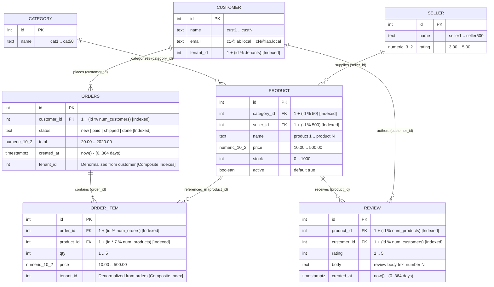

# Database Schema & Multi-Tenant SQL Workload Catalog

> 🇧🇷 **[Versão em português](README-pt.md)**

This directory contains all `pgbench` SQL workload scripts used to benchmark **PostgreSQL 17 (Origin / Path A)** against **PgCache (Read Cache Proxy / Path B)** across lightweight operational dashboards, mixed read/write invalidation mixes, and complex multi-tenant enterprise screens (substring text search, 4-to-6 table `INNER JOIN` and `LEFT JOIN` chains, and multi-dimensional analytical aggregations).

---

## Table of Contents

1. [Workload Files Overview](#1-workload-files-overview)
2. [Database Modeling & Entity-Relationship Diagram](#2-database-modeling--entity-relationship-diagram)
   - [2.1 Entity-Relationship Diagram (Mermaid)](#21-entity-relationship-diagram-mermaid)
   - [2.2 Tables, Cardinalities & Scale Factors](#22-tables-cardinalities--scale-factors)
   - [2.3 Step 1 — Normalized Base Schema (`sql/01-schema.sql`)](#23-step-1--normalized-base-schema-sql01-schemasql)
   - [2.4 Step 2 — Multi-Tenant Denormalization & Indexing (`sql/02-tenant.sql`)](#24-step-2--multi-tenant-denormalization--indexing-sql02-tenantsql)
   - [2.5 Complete Index Catalog](#25-complete-index-catalog)
3. [Protocol & Query Design Invariants for PgCache](#3-protocol--query-design-invariants-for-pgcache)
4. [Baseline Workloads (`01`–`03` Sweeps)](#4-baseline-workloads-0103-sweeps)
   - [4.1 `dashboard.sql` — Operational SaaS Dashboard (8 Statements)](#41-dashboardsql--operational-saas-dashboard-8-statements)
   - [4.2 `write.sql` — Tenant-Scoped Write Workload (1 Statement)](#42-writesql--tenant-scoped-write-workload-1-statement)
5. [Complex Multi-Tenant Workloads (`04-complex-sweep.sh`)](#5-complex-multi-tenant-workloads-04-complex-sweepsh)
   - [5.1 `complex-search.sql` — Substring Text Search (`ILIKE '%...%'`, 4 Statements)](#51-complex-searchsql--substring-text-search-ilike--4-statements)
   - [5.2 `complex-joins.sql` — Deep 4-to-6 Table `JOIN` & `LEFT JOIN` Chains (4 Statements)](#52-complex-joinssql--deep-4-to-6-table-join--left-join-chains-4-statements)
   - [5.3 `complex-analytics.sql` — Multi-Dimensional Analytical Rollups (4 Statements)](#53-complex-analyticssql--multi-dimensional-analytical-rollups-4-statements)
   - [5.4 `complex-dashboard.sql` — Unified Enterprise Analytics & Search Screen (8 Statements)](#54-complex-dashboardsql--unified-enterprise-analytics--search-screen-8-statements)
   - [5.5 `complex-dashboard-zipfian.sql` — Pareto 80/20 Enterprise Traffic (8 Statements)](#55-complex-dashboard-zipfiansql--pareto-8020-enterprise-traffic-8-statements)
6. [Performance Summary Across Workloads (3-Node Cloud Cluster)](#6-performance-summary-across-workloads-3-node-cloud-cluster)

---

## 1. Workload Files Overview

| Script | Statements | Tables Touched | Primary Relational Patterns | Benchmark Sweep |
|---|---:|---|---|---|
| [`dashboard.sql`](dashboard.sql) | 8 | `orders`, `customer`, `order_item`, `product` | Point counts, single-table `GROUP BY`, keyset/offset pagination, 2-table `INNER JOIN` (100% cacheable) | `01-tenant-sweep.sh`, `02-concurrency-sweep.sh`, `03-write-sweep.sh` |
| [`write.sql`](write.sql) | 2 | `orders`, `order_item` | Tenant-scoped `UPDATE orders` + `INSERT INTO order_item` | `03-write-sweep.sh`, `04-complex-sweep.sh writes` |
| [`complex-search.sql`](complex-search.sql) | 4 | All 7 tables | Leading-wildcard `ILIKE '%...%'` substring search + 3-to-6 table `JOIN` & `LEFT JOIN` | `04-complex-sweep.sh scenarios` |
| [`complex-joins.sql`](complex-joins.sql) | 4 | All 7 tables | Deep 4-to-6 table `INNER JOIN` & multi-hop `LEFT JOIN` (preserving zero-order customers and unreviewed products) | `04-complex-sweep.sh scenarios` |
| [`complex-analytics.sql`](complex-analytics.sql) | 4 | All 7 tables | Multi-dimensional `GROUP BY`, `FILTER (WHERE ...)`, `CASE WHEN` ticket buckets, `HAVING` thresholds | `04-complex-sweep.sh scenarios` |
| [`complex-dashboard.sql`](complex-dashboard.sql) | 8 | All 7 tables | Unified enterprise screen combining 3 analytical rollups, 3 deep `JOIN`/`LEFT JOIN` views, and 2 `ILIKE` searches (Uniform tenant selection) | `04-complex-sweep.sh` (`scenarios`, `tenants`, `clients`, `writes`) |
| [`complex-dashboard-zipfian.sql`](complex-dashboard-zipfian.sql) | 8 | All 7 tables | Same 8-statement enterprise screen using realistic **Pareto 80/20 (`random_zipfian(1, :tenants, 1.07)`)** tenant selection | `04-complex-sweep.sh` (`scenarios`, `zipfian`) |

---

## 2. Database Modeling & Entity-Relationship Diagram

The database models a multi-tenant B2B/B2C e-commerce SaaS platform consisting of **7 relational tables**:
- **Shared Global Catalog Dimension Tables**: `category`, `seller`, `product`
- **Tenant-Scoped Operational & Transactional Tables**: `customer`, `orders`, `order_item`
- **Customer Feedback Table**: `review` (linked to tenant-scoped `customer` and global `product`)

### 2.1 Entity-Relationship Diagram (Mermaid)



### 2.2 Tables, Cardinalities & Scale Factors

Database seeding is parameterized by `:scale` (default `1`) and `:tenants` (default `200`, scaled up to `2,000` active tenants):

| Table | Tenant Scoping | Row Count (`SCALE=1`) | Row Count (`SCALE=5`) | Row Count (`SCALE=10`) | Rows per Tenant (`SCALE=1, TENANTS=200`) | Rows per Tenant (`SCALE=1, TENANTS=2000`) |
|---|---|---:|---:|---:|---:|---:|
| `category` | Shared catalog | 50 | 50 | 50 | 50 (shared) | 50 (shared) |
| `seller` | Shared catalog | 500 | 500 | 500 | 500 (shared) | 500 (shared) |
| `product` | Shared catalog | 200,000 | 1,000,000 | 2,000,000 | 200,000 (shared) | 200,000 (shared) |
| `customer` | Native `tenant_id` | 100,000 | 500,000 | 1,000,000 | 500 | 50 |
| `orders` | Denormalized `tenant_id` | 500,000 | 2,500,000 | 5,000,000 | 2,500 | 250 |
| `order_item` | Denormalized `tenant_id` | 2,000,000 | 10,000,000 | 20,000,000 | 10,000 | 1,000 |
| `review` | Via `customer.tenant_id` | 300,000 | 1,500,000 | 3,000,000 | 1,500 | 150 |
| **Total DB Size** | — | **~463–594 MB** | **~2.3 GB** | **~4.6 GB** | — | — |

> [!IMPORTANT]
> At `SCALE=1` (~463–594 MB), the **entire database fits inside Origin PostgreSQL's `shared_buffers` (512 MB–1 GB)**, operating at a **~99.9%+ buffer cache hit rate** in RAM. Any performance gain achieved by PgCache comes purely from bypassing relational query execution (joins, aggregations, sorting, substring scans) rather than avoiding disk I/O.

### 2.3 Step 1 — Normalized Base Schema ([`sql/01-schema.sql`](../sql/01-schema.sql))

```sql
CREATE TABLE category (
  id   int PRIMARY KEY,
  name text NOT NULL
);

CREATE TABLE seller (
  id     int PRIMARY KEY,
  name   text NOT NULL,
  rating numeric(3,2)
);

CREATE TABLE customer (
  id        int PRIMARY KEY,
  name      text NOT NULL,
  email     text NOT NULL,
  tenant_id int  NOT NULL
);

CREATE TABLE product (
  id          int PRIMARY KEY,
  category_id int NOT NULL REFERENCES category(id),
  seller_id   int NOT NULL REFERENCES seller(id),
  name        text NOT NULL,
  price       numeric(10,2) NOT NULL,
  stock       int NOT NULL,
  active      boolean NOT NULL DEFAULT true
);

CREATE TABLE orders (
  id          int PRIMARY KEY,
  customer_id int NOT NULL REFERENCES customer(id),
  status      text NOT NULL,
  total       numeric(10,2) NOT NULL,
  created_at  timestamptz NOT NULL
);

CREATE TABLE order_item (
  id         int PRIMARY KEY,
  order_id   int NOT NULL REFERENCES orders(id),
  product_id int NOT NULL REFERENCES product(id),
  qty        int NOT NULL,
  price      numeric(10,2) NOT NULL
);

CREATE TABLE review (
  id          int PRIMARY KEY,
  product_id  int NOT NULL REFERENCES product(id),
  customer_id int NOT NULL REFERENCES customer(id),
  rating      int NOT NULL,
  body        text NOT NULL,
  created_at  timestamptz NOT NULL
);
```

### 2.4 Step 2 — Multi-Tenant Denormalization & Indexing ([`sql/02-tenant.sql`](../sql/02-tenant.sql))

In a real multi-tenant SaaS database, filtering `orders` or `order_item` through a join to `customer` on every query forces unnecessary join hops. Step 2 denormalizes `tenant_id` directly onto `orders` and `order_item` and builds composite indexes leading with `tenant_id`:

```sql
ALTER TABLE orders     ADD COLUMN IF NOT EXISTS tenant_id int;
ALTER TABLE order_item ADD COLUMN IF NOT EXISTS tenant_id int;

UPDATE orders
   SET tenant_id = 1 + (customer_id % :tenants)
 WHERE tenant_id IS NULL;

UPDATE order_item oi
   SET tenant_id = o.tenant_id
  FROM orders o
 WHERE o.id = oi.order_id
   AND oi.tenant_id IS NULL;

ALTER TABLE orders     ALTER COLUMN tenant_id SET NOT NULL;
ALTER TABLE order_item ALTER COLUMN tenant_id SET NOT NULL;

CREATE INDEX IF NOT EXISTS orders_tenant_created ON orders(tenant_id, created_at DESC);
CREATE INDEX IF NOT EXISTS orders_tenant_status  ON orders(tenant_id, status);
CREATE INDEX IF NOT EXISTS oitem_tenant_product  ON order_item(tenant_id, product_id);
```

### 2.5 Complete Index Catalog

| Table | Index Name / Definition | Columns | Purpose in Queries |
|---|---|---|---|
| `category` | `category_pkey` | `(id)` | Primary key lookup in product/category joins |
| `seller` | `seller_pkey` | `(id)` | Primary key lookup in product/seller joins |
| `customer` | `customer_pkey` | `(id)` | Primary key lookup for order/review authors |
| `customer` | `customer_tenant_id_idx` | `(tenant_id)` | Scopes customer counts, searches, and cohorts to `:t` |
| `product` | `product_pkey` | `(id)` | Primary key lookup from `order_item` and `review` |
| `product` | `product_category_id_idx` | `(category_id)` | Foreign key index for category rollups |
| `product` | `product_seller_id_idx` | `(seller_id)` | Foreign key index for seller rollups |
| `orders` | `orders_pkey` | `(id)` | Primary key lookup from `order_item` and `write.sql` |
| `orders` | `orders_customer_id_idx` | `(customer_id)` | Foreign key index for `customer LEFT JOIN orders` |
| `orders` | `orders_status_idx` | `(status)` | Secondary status filter index |
| `orders` | `orders_tenant_created` | `(tenant_id, created_at DESC)` | Composite index for recent-orders pagination (`ORDER BY created_at DESC LIMIT 20`) |
| `orders` | `orders_tenant_status` | `(tenant_id, status)` | Composite index for status counts (`GROUP BY status`, `WHERE tenant_id = :t AND status = ...`) |
| `order_item` | `order_item_pkey` | `(id)` | Primary key & sort order for line-item pagination |
| `order_item` | `order_item_order_id_idx` | `(order_id)` | Foreign key index for `orders JOIN order_item` |
| `order_item` | `order_item_product_id_idx` | `(product_id)` | Foreign key index for `product JOIN order_item` |
| `order_item` | `oitem_tenant_product` | `(tenant_id, product_id)` | Composite index for tenant-scoped line-item joins and product aggregations |
| `review` | `review_pkey` | `(id)` | Primary key |
| `review` | `review_product_id_idx` | `(product_id)` | Foreign key index for `LEFT JOIN review ON r.product_id = p.id` |
| `review` | `review_customer_id_idx` | `(customer_id)` | Foreign key index for customer review lookups |

---

## 3. Protocol & Query Design Invariants for PgCache

Every SQL script in this directory adheres to four strict invariants:

1. **Simple Query Protocol (`-M simple`) & Zero Explicit Transactions**:
   - `pgbench` is always invoked with `-M simple`, interpolating variables (`:t`, `:off`, `:st`, `:n`) directly into the SQL string before sending.
   - Scripts **never** use `BEGIN ... COMMIT` blocks because PgCache treats explicit transactions as write-capable and passes them directly to Origin.
2. **Explicit `:t` Tenant Literal Predicates on Every Joined Tenant Table**:
   - In multi-table `INNER JOIN` queries touching `orders o`, `order_item oi`, and `customer c`, `WHERE` clauses explicitly include `o.tenant_id = :t AND oi.tenant_id = :t AND c.tenant_id = :t`.
   - In `LEFT JOIN` queries, the `ON` clause includes `AND o.tenant_id = :t` / `AND oi.tenant_id = :t`.
   - This allows PgCache to scope Change Data Capture (CDC) invalidations per tenant and enables PostgreSQL to push down tenant index scans during cache population.
3. **100% Materialized View (MV) Gate Admission (`OFFSET 0` & Base-Column `GROUP BY`)**:
   - Complex multi-table queries omit `OFFSET` (or use `OFFSET 0`) and group directly on base entity columns (`GROUP BY p.id, p.name, ...`) so 100% of complex queries pass PgCache 0.7+'s Materialized View gate (`pgcache_cache_mv_gate{outcome="admit"}`) and serve warm hits directly from `pgcache_mv.q_<hash>` (`pgcache_cache_mv_hits`) in **~0.3 ms per statement**.
4. **All 7 Tables Declared in `ALLOWED_TABLES`**:
   - `ALLOWED_TABLES=product,category,seller,customer,orders,order_item,review`.

---

## 4. Baseline Workloads (`01`–`03` Sweeps)

### 4.1 [`dashboard.sql`](dashboard.sql) — Operational SaaS Dashboard (8 Statements)

Simulates loading the main operational dashboard of a tenant organization. One `pgbench` transaction executes **8 sequential SQL statements**:

#### Variables
```sql
\set t         random(1, :tenants)
\set off       random(0, 9)
\set off_rows  :off * 20
\set st        random(1, 4)
\set min_total :st * 50
```

#### Statements

```sql
-- Statement 1: Order counts by status (KPI summary cards at top of dashboard)
SELECT status, count(*) FROM orders WHERE tenant_id = :t GROUP BY status ORDER BY status;

-- Statement 2: Total revenue and total order count for the tenant
SELECT sum(total), count(*) FROM orders WHERE tenant_id = :t;

-- Statement 3: Total customer count belonging to the tenant
SELECT count(*) FROM customer WHERE tenant_id = :t;

-- Statement 4: Paginated recent orders list (pre-computed :off_rows for 100% cacheability)
SELECT id, status, total, created_at
  FROM orders WHERE tenant_id = :t
 ORDER BY created_at DESC, id DESC LIMIT 20 OFFSET :off_rows;

-- Statement 5: Filtered order count badge for a specific minimum order value tier
SELECT count(*) FROM orders
 WHERE tenant_id = :t AND total >= :min_total;

-- Statement 6: Recent 10 orders enriched with customer name (2-table INNER JOIN)
SELECT o.id, o.total, c.name
  FROM orders o JOIN customer c ON c.id = o.customer_id
 WHERE o.tenant_id = :t AND c.tenant_id = :t
 ORDER BY o.created_at DESC, o.id DESC LIMIT 10;

-- Statement 7: Top 10 best-selling products by quantity for the tenant (2-table JOIN + GROUP BY + ORDER BY)
SELECT p.name, sum(oi.qty)
  FROM order_item oi JOIN product p ON p.id = oi.product_id
 WHERE oi.tenant_id = :t
 GROUP BY p.id, p.name ORDER BY 2 DESC, p.id ASC LIMIT 10;

-- Statement 8: Paginated order line items with product name (2-table JOIN + pagination)
SELECT oi.id, oi.qty, oi.price, p.name
  FROM order_item oi JOIN product p ON p.id = oi.product_id
 WHERE oi.tenant_id = :t
 ORDER BY oi.id DESC LIMIT 20 OFFSET :off_rows;
```

---

### 4.2 [`write.sql`](write.sql) — Tenant-Scoped Write Workload (`UPDATE` + `INSERT`, 2 Statements)

Used in mixed read/write sweeps (`pgbench -f dashboard.sql@95 -f write.sql@5` or `-f complex-dashboard.sql@95 -f write.sql@5`) to generate realistic tenant-scoped writes (both updating an existing order and inserting a new order line item) that trigger logical replication (CDC) invalidations in PgCache:

#### Variables & Statements
```sql
\set t     random(1, :wtenants)
\set n     random(0, 200)
\set qty   random(1, 5)
\set price random(10, 250)
\set prod  random(1, 1000)

-- 1. Update an existing order total for tenant :t
UPDATE orders SET total = total + 1
 WHERE id IN (
   SELECT id FROM orders WHERE tenant_id = :t ORDER BY id OFFSET :n LIMIT 1
 );

-- 2. Insert a new order_item row for tenant :t (uses order_item_id_seq >= 100,000,000)
INSERT INTO order_item (order_id, product_id, qty, price, tenant_id)
SELECT o.id, :prod, :qty, :price, :t
  FROM orders o
 WHERE o.tenant_id = :t
 ORDER BY o.id
OFFSET :n
 LIMIT 1;
```

- **Why `:wtenants` is separate from `:tenants`**: Allows testing write concentration (e.g. `wtenants=1` or `wtenants=10`, where a handful of noisy tenants generate all writes while 200–1,000 tenants read) versus uniform write dispersion (`wtenants=tenants`).

---

## 5. Complex Multi-Tenant Workloads (`04-complex-sweep.sh`)

While [`dashboard.sql`](dashboard.sql) focuses on fast index lookups and 2-table joins (~23–37 ms total for 8 statements on Origin), enterprise SaaS applications frequently render screens with substring filters, multi-hop outer joins, and multi-dimensional OLAP aggregations that take **75–210+ ms** on Origin.

### 5.1 [`complex-search.sql`](complex-search.sql) — Substring Text Search (`ILIKE '%...%'`, 4 Statements)

Evaluates leading-wildcard case-insensitive substring searches (`ILIKE '%...%'`) combined with 3-to-6 table `JOIN` and `LEFT JOIN` chains. Because standard B-Tree indexes cannot range-scan leading wildcards, Origin must scan all qualifying tenant rows and evaluate text predicates tuple-by-tuple.

```sql
\set t random(1, :tenants)

-- Search 1: Customer directory search (name or email ILIKE '%1%') with lifetime order count
--           and item spend via multi-hop LEFT JOIN (preserves customers with 0 orders).
SELECT c.id, c.name, c.email,
       count(DISTINCT o.id) AS order_cnt,
       coalesce(sum(oi.qty * oi.price), 0) AS lifetime_spend
  FROM customer c
  LEFT JOIN orders o      ON o.customer_id = c.id AND o.tenant_id = :t
  LEFT JOIN order_item oi ON oi.order_id = o.id AND oi.tenant_id = :t
 WHERE c.tenant_id = :t
   AND (c.name ILIKE '%1%' OR c.email ILIKE '%1%')
 GROUP BY c.id, c.name, c.email
 ORDER BY lifetime_spend DESC, c.id ASC
 LIMIT 15;

-- Search 2: Product catalog search across tenant purchases (p.name ILIKE '%1%' AND price >= 50)
--           across 6 tables (order_item -> orders -> product -> category -> seller -> LEFT JOIN review).
SELECT p.id, p.name, cat.name AS category_name, s.name AS seller_name,
       sum(oi.qty) AS total_units,
       sum(oi.qty * oi.price) AS gross_revenue,
       count(r.id) AS review_cnt,
       coalesce(round(avg(r.rating), 2), 0) AS avg_rating
  FROM order_item oi
  JOIN orders o      ON o.id = oi.order_id
  JOIN product p     ON p.id = oi.product_id
  JOIN category cat  ON cat.id = p.category_id
  JOIN seller s      ON s.id = p.seller_id
  LEFT JOIN review r ON r.product_id = p.id AND r.customer_id = o.customer_id
 WHERE oi.tenant_id = :t
   AND o.tenant_id = :t
   AND p.name ILIKE '%1%'
   AND p.price >= 50
 GROUP BY p.id, p.name, cat.name, s.name
 ORDER BY gross_revenue DESC, p.id ASC
 LIMIT 15;

-- Search 3: Customer review body text search (r.body ILIKE '%1%' AND rating >= 2)
--           enriched with product category and customer completed-order count (5 tables).
SELECT r.id, r.rating, r.body,
       p.name AS product_name,
       cat.name AS category_name,
       c.name AS customer_name,
       count(o.id) AS customer_done_orders
  FROM review r
  JOIN customer c    ON c.id = r.customer_id
  JOIN product p     ON p.id = r.product_id
  JOIN category cat  ON cat.id = p.category_id
  LEFT JOIN orders o ON o.customer_id = c.id AND o.tenant_id = :t AND o.status = 'done'
 WHERE c.tenant_id = :t
   AND r.body ILIKE '%1%'
   AND r.rating >= 2
 GROUP BY r.id, r.rating, r.body, p.name, cat.name, c.name
 ORDER BY r.rating DESC, customer_done_orders DESC, r.id ASC
 LIMIT 15;

-- Search 4: Cross-entity order fulfillment search matching product name or customer email
--           (p.name ILIKE '%2%' OR c.email ILIKE '%2%') across 5 joined tables.
SELECT o.id AS order_id, o.status, o.created_at,
       c.name AS customer_name,
       p.name AS product_name,
       cat.name AS category_name,
       sum(oi.qty) AS total_qty,
       sum(oi.qty * oi.price) AS line_total
  FROM orders o
  JOIN customer c    ON c.id = o.customer_id
  JOIN order_item oi ON oi.order_id = o.id
  JOIN product p     ON p.id = oi.product_id
  JOIN category cat  ON cat.id = p.category_id
 WHERE o.tenant_id = :t
   AND oi.tenant_id = :t
   AND c.tenant_id = :t
   AND (p.name ILIKE '%2%' OR c.email ILIKE '%2%')
   AND o.total >= 50
 GROUP BY o.id, o.status, o.created_at, c.name, p.name, cat.name
 ORDER BY o.created_at DESC, o.id DESC, p.name ASC
 LIMIT 15;
```

---

### 5.2 [`complex-joins.sql`](complex-joins.sql) — Deep 4-to-6 Table `JOIN` & `LEFT JOIN` Chains (4 Statements)

Evaluates multi-hop relational join chains across 4 to 6 tables, combining `INNER JOIN` with `LEFT JOIN` to preserve parent entities that have zero matching child records (e.g., dormant customers with zero completed orders, or purchased products with zero customer reviews).

```sql
\set t random(1, :tenants)

-- Join 1: 6-table enriched order line view with optional customer product review
--         (orders -> customer -> order_item -> product -> category -> seller -> LEFT JOIN review).
SELECT o.id AS order_id, o.status, o.created_at,
       c.name AS customer_name,
       p.name AS product_name,
       cat.name AS category_name,
       s.name AS seller_name,
       oi.id AS item_id, oi.qty, oi.price,
       coalesce(max(r.rating), 0) AS customer_rating
  FROM orders o
  JOIN customer c    ON c.id = o.customer_id
  JOIN order_item oi ON oi.order_id = o.id
  JOIN product p     ON p.id = oi.product_id
  JOIN category cat  ON cat.id = p.category_id
  JOIN seller s      ON s.id = p.seller_id
  LEFT JOIN review r ON r.product_id = p.id AND r.customer_id = c.id
 WHERE o.tenant_id = :t
   AND oi.tenant_id = :t
   AND c.tenant_id = :t
 GROUP BY o.id, o.status, o.created_at, c.name, p.name, cat.name, s.name, oi.id, oi.qty, oi.price
 ORDER BY o.created_at DESC, oi.id DESC
 LIMIT 20;

-- Join 2: Customer retention & dormancy view (customer LEFT JOIN orders LEFT JOIN order_item)
--         preserving customers with zero completed ('done') orders.
SELECT c.id, c.name, c.email,
       count(DISTINCT o.id) AS completed_orders,
       coalesce(sum(oi.qty), 0) AS total_items_bought,
       coalesce(sum(oi.qty * oi.price), 0) AS completed_spend
  FROM customer c
  LEFT JOIN orders o      ON o.customer_id = c.id AND o.tenant_id = :t AND o.status = 'done'
  LEFT JOIN order_item oi ON oi.order_id = o.id AND oi.tenant_id = :t
 WHERE c.tenant_id = :t
 GROUP BY c.id, c.name, c.email
 ORDER BY completed_spend DESC, c.id ASC
 LIMIT 10;

-- Join 3: Purchased product coverage with unreviewed inventory detection (6 tables).
SELECT p.id, p.name AS product_name,
       cat.name AS category_name,
       s.name AS seller_name,
       count(DISTINCT o.customer_id) AS unique_buyers,
       sum(oi.qty) AS units_sold,
       sum(oi.qty * oi.price) AS gross_revenue,
       count(r.id) AS tenant_reviews,
       coalesce(round(avg(r.rating), 2), 0) AS avg_tenant_rating
  FROM order_item oi
  JOIN orders o      ON o.id = oi.order_id
  JOIN product p     ON p.id = oi.product_id
  JOIN category cat  ON cat.id = p.category_id
  JOIN seller s      ON s.id = p.seller_id
  LEFT JOIN review r ON r.product_id = p.id AND r.customer_id = o.customer_id
 WHERE oi.tenant_id = :t
   AND o.tenant_id = :t
 GROUP BY p.id, p.name, cat.name, s.name
 ORDER BY units_sold DESC, gross_revenue DESC, p.id ASC
 LIMIT 20;

-- Join 4: Seller-to-category product fulfillment & customer feedback matrix (6 tables).
SELECT s.id AS seller_id, s.name AS seller_name, s.rating AS seller_rating,
       cat.name AS category_name,
       p.id AS product_id, p.name AS product_name,
       count(DISTINCT o.id) AS order_count,
       sum(oi.qty * oi.price) AS gross_sales,
       count(r.id) AS feedback_count,
       coalesce(round(avg(r.rating), 2), 0) AS avg_feedback_score
  FROM seller s
  JOIN product p     ON p.seller_id = s.id
  JOIN category cat  ON cat.id = p.category_id
  JOIN order_item oi ON oi.product_id = p.id
  JOIN orders o      ON o.id = oi.order_id
  LEFT JOIN review r ON r.product_id = p.id AND r.customer_id = o.customer_id
 WHERE oi.tenant_id = :t
   AND o.tenant_id = :t
   AND s.rating >= 3
 GROUP BY s.id, s.name, s.rating, cat.name, p.id, p.name
 ORDER BY gross_sales DESC, s.id ASC, p.id ASC
 LIMIT 20;
```

---

### 5.3 [`complex-analytics.sql`](complex-analytics.sql) — Multi-Dimensional Analytical Rollups (4 Statements)

Evaluates heavy OLAP-style aggregations over multi-tenant operational data using conditional `FILTER (WHERE ...)` clauses, `CASE WHEN` price-tier bucketing, `COUNT(DISTINCT ...)`, multi-column `GROUP BY`, and post-aggregation `HAVING` thresholds.

```sql
\set t random(1, :tenants)

-- Analytics 1: Category & product revenue funnel with conditional FILTER (WHERE ...) aggregates (4 tables).
SELECT cat.id AS category_id, cat.name AS category_name,
       p.id AS product_id, p.name AS product_name,
       count(DISTINCT o.id) AS total_orders,
       count(DISTINCT o.id) FILTER (WHERE o.status = 'done') AS done_orders,
       count(DISTINCT o.id) FILTER (WHERE o.status = 'new') AS pending_orders,
       coalesce(sum(oi.qty * oi.price) FILTER (WHERE o.status IN ('paid', 'shipped', 'done')), 0) AS settled_revenue,
       round(avg(oi.qty * oi.price), 2) AS avg_item_revenue
  FROM order_item oi
  JOIN orders o     ON o.id = oi.order_id
  JOIN product p    ON p.id = oi.product_id
  JOIN category cat ON cat.id = p.category_id
 WHERE oi.tenant_id = :t
   AND o.tenant_id = :t
 GROUP BY cat.id, cat.name, p.id, p.name
 ORDER BY settled_revenue DESC, cat.id ASC, p.id ASC
 LIMIT 20;

-- Analytics 2: Seller & product performance rollup with CASE WHEN ticket-size buckets and HAVING (4 tables).
SELECT s.id AS seller_id, s.name AS seller_name, s.rating AS seller_rating,
       p.id AS product_id, p.name AS product_name,
       count(DISTINCT o.id) AS order_cnt,
       count(DISTINCT o.customer_id) AS unique_buyers,
       sum(CASE WHEN oi.price >= 200 THEN oi.qty * oi.price ELSE 0 END) AS high_ticket_revenue,
       sum(CASE WHEN oi.price < 200 THEN oi.qty * oi.price ELSE 0 END) AS standard_ticket_revenue,
       sum(oi.qty * oi.price) AS total_revenue
  FROM order_item oi
  JOIN orders o  ON o.id = oi.order_id
  JOIN product p ON p.id = oi.product_id
  JOIN seller s  ON s.id = p.seller_id
 WHERE oi.tenant_id = :t
   AND o.tenant_id = :t
 GROUP BY s.id, s.name, s.rating, p.id, p.name
HAVING sum(oi.qty * oi.price) >= 400
 ORDER BY total_revenue DESC, s.id ASC, p.id ASC
 LIMIT 20;

-- Analytics 3: Customer lifecycle & order status cohort rollup including zero-order accounts (LEFT JOIN + FILTER).
SELECT c.id AS customer_id, c.name AS customer_name, c.email,
       count(DISTINCT o.id) AS total_orders,
       count(DISTINCT o.id) FILTER (WHERE o.status = 'done') AS done_orders,
       count(DISTINCT o.id) FILTER (WHERE o.status IN ('new', 'paid', 'shipped')) AS active_orders,
       coalesce(sum(oi.qty * oi.price), 0) AS lifetime_revenue,
       coalesce(max(o.total), 0) AS max_order_value
  FROM customer c
  LEFT JOIN orders o      ON o.customer_id = c.id AND o.tenant_id = :t
  LEFT JOIN order_item oi ON oi.order_id = o.id AND oi.tenant_id = :t
 WHERE c.tenant_id = :t
 GROUP BY c.id, c.name, c.email
 ORDER BY lifetime_revenue DESC, c.id ASC
 LIMIT 15;

-- Analytics 4: Category x Seller x Product cross-tabulation with review quality score and HAVING (6 tables).
SELECT cat.name AS category_name,
       s.name AS seller_name,
       p.id AS product_id, p.name AS product_name,
       count(DISTINCT o.id) AS orders_cnt,
       sum(oi.qty) AS total_units,
       sum(oi.qty * oi.price) AS gross_revenue,
       round(avg(oi.price), 2) AS avg_unit_price,
       count(r.id) AS review_cnt,
       coalesce(round(avg(r.rating), 2), 0) AS avg_review_rating
  FROM order_item oi
  JOIN orders o      ON o.id = oi.order_id
  JOIN product p     ON p.id = oi.product_id
  JOIN category cat  ON cat.id = p.category_id
  JOIN seller s      ON s.id = p.seller_id
  LEFT JOIN review r ON r.product_id = p.id AND r.customer_id = o.customer_id
 WHERE oi.tenant_id = :t
   AND o.tenant_id = :t
 GROUP BY cat.name, s.name, p.id, p.name
HAVING count(oi.id) >= 3
 ORDER BY gross_revenue DESC, p.id ASC
 LIMIT 20;
```

---

### 5.4 [`complex-dashboard.sql`](complex-dashboard.sql) — Unified Enterprise Analytics & Search Screen (8 Statements)

Models a full enterprise SaaS analytics & search screen by combining **8 complex statements** (drawn from the 3 complex suites above) into a single `pgbench` transaction:

| Statement # | Source Query | Relational Shape | Join Type & CDC Behavior Under `UPDATE orders` |
|:---:|---|---|---|
| **#1** | `complex-analytics.sql` #1 | 4-table Category × Product revenue funnel (`FILTER WHERE`) | `INNER JOIN` (`WHERE o.tenant_id = :t`) — **Tenant-scoped in-place CDC update** |
| **#2** | `complex-analytics.sql` #2 | 4-table Seller × Product ticket buckets (`CASE WHEN` + `HAVING`) | `INNER JOIN` (`WHERE o.tenant_id = :t`) — **Tenant-scoped in-place CDC update** |
| **#3** | `complex-analytics.sql` #3 | 3-table Customer lifecycle cohort (`LEFT JOIN` + `FILTER WHERE`) | `LEFT JOIN` (`ON o.tenant_id = :t`) — Conservative outer-join invalidation |
| **#4** | `complex-joins.sql` #1 | 6-table Enriched order lines + optional review (`LEFT JOIN review`) | `INNER JOIN` on `orders` (`WHERE o.tenant_id = :t`) — **Tenant-scoped in-place CDC update** |
| **#5** | `complex-joins.sql` #2 | 3-table Customer retention & dormancy (`LEFT JOIN orders`) | `LEFT JOIN` (`ON o.tenant_id = :t`) — Conservative outer-join invalidation |
| **#6** | `complex-analytics.sql` #4 | 6-table Category × Seller × Product review matrix (`HAVING`) | `INNER JOIN` on `orders` (`WHERE o.tenant_id = :t`) — **Tenant-scoped in-place CDC update** |
| **#7** | `complex-search.sql` #1 | 3-table Customer directory `ILIKE '%1%'` search (`LEFT JOIN orders`) | `LEFT JOIN` (`ON o.tenant_id = :t`) — Conservative outer-join invalidation |
| **#8** | `complex-search.sql` #2 | 6-table Product catalog `ILIKE '%1%'` search (`LEFT JOIN review`) | `INNER JOIN` on `orders` (`WHERE o.tenant_id = :t`) — **Tenant-scoped in-place CDC update** |

---

### 5.5 [`complex-dashboard-zipfian.sql`](complex-dashboard-zipfian.sql) — Pareto 80/20 Enterprise Traffic (8 Statements)

Identical to `complex-dashboard.sql` in its 8 SQL queries, except tenant selection follows a **Zipfian / Pareto distribution (`s = 1.07`)** instead of a flat uniform distribution:

```sql
\set t random_zipfian(1, :tenants, 1.07)
```

In real multi-tenant SaaS systems, roughly 20% of tenants generate 80% of traffic. Using `complex-dashboard-zipfian.sql` tests how PgCache behaves at high tenant counts (up to **2,000 tenants**) when a realistic hot cohort drives the majority of requests.

---

## 6. Performance Summary Across Workloads (3-Node Cloud Cluster)

Measured across **5 independent pod-recreated trials (`TRIALS=5`)** on a **3-node Kubernetes cloud cluster** (`PgCache 0.7.1`, `TENANTS=200`, `CLIENTS=8`):

| Workload Script | Statements | PostgreSQL Direct (Path A) | PgCache 0.7.1 (Path B) | Cache Hit Rate | Average Speedup (5-Run Spread) |
|---|---:|---|---|---:|---|
| [`dashboard.sql`](dashboard.sql) (`dash_base`) | 8 | 57.8 ms · **146 req/s** *(±40.5 sd)* | **29.4 ms · 273 req/s** *(±16.3 sd)* | **100.0%** | **1.98× (`+98%`)** |
| [`complex-search.sql`](complex-search.sql) (`search`) | 4 | 129.6 ms · **63 req/s** *(±9.2 sd)* | **6.9 ms · 1,170 req/s** *(±126.1 sd)* | **100.0%** | **18.8× (`+1,778%`)** |
| [`complex-joins.sql`](complex-joins.sql) (`joins`) | 4 | 238.9 ms · **34 req/s** *(±2.8 sd)* | **8.2 ms · 991 req/s** *(±160.6 sd)* | **100.0%** | **29.4× (`+2,839%`)** |
| [`complex-analytics.sql`](complex-analytics.sql) (`analytics`) | 4 | 175.3 ms · **46 req/s** *(±4.1 sd)* | **9.0 ms · 905 req/s** *(±122.1 sd)* | **100.0%** | **19.8× (`+1,883%`)** |
| [`complex-dashboard.sql`](complex-dashboard.sql) (`cplx_dash`) | 8 | 307.5 ms · **26 req/s** *(±1.2 sd)* | **23.4 ms · 389 req/s** *(±132.6 sd)* | **100.0%** | **15.0× (`+1,400%`)** |
| [`complex-dashboard-zipfian.sql`](complex-dashboard-zipfian.sql) (`z_tenants=200`) | 8 | 339.2 ms · **24 req/s** *(±4.1 sd)* | **76.0 ms · 267 req/s** *(±191.3 sd)* | **97.5%** | **11.5× (`+1,051%`)** |

For the complete 5-run breakdown and raw logs, see [`../results/0.7.1/README.md`](../results/0.7.1/README.md) and [`../README.md`](../README.md).
